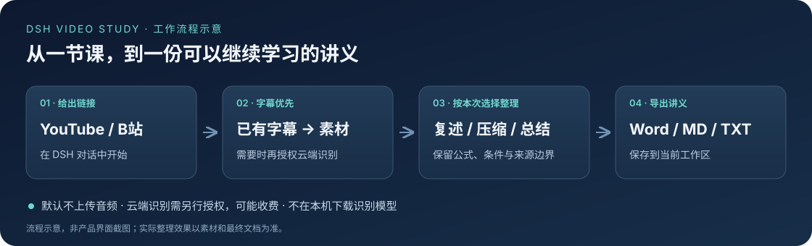

# dsh-video-study

**把 YouTube / B站课程整理成可以继续学习、编辑的中文讲义。**

这是 [DeepSeek Harness（DSH）](https://github.com/deepseek-ai/deepseek-harness) 的视频学习插件，不是独立播放器。在对话里给出课程链接，选择完整复述、简要压缩或总结，由助手整理为 Word、Markdown 或 TXT。

云端稳定版 0.9.2 · [开始使用](docs/getting-started.md) · [云端配置](docs/cloud-services.md) · [常见问题](docs/troubleshooting.md)




## 它能帮你做什么

- **把课程变成讲义**：读取 YouTube / B站已有字幕，整理为中文正文；B站链接保留分 P。
- **按这次学习目标整理**：每次选择「原文（完全复述）」「简要压缩」或「总结」，不沿用上次的选择。
- **继续编辑和复习**：导出 `.docx`、`.md` 或 `.txt`；Word 支持将部分 LaTeX 转成可编辑公式。
- **字幕不够时再识别**：可配置云端 ASR（语音转文字），无需在本机下载识别模型。
- **在 DSH 内完成设置**：一键准备 Python 配套环境、检查环境，以及 B站扫码登录。

**默认只取已有字幕，不上传音频。** 切换云端模式并勾选上传授权后，缺少可用字幕等允许的场景才会上传音轨，服务商可能收费。


## 第一次使用

### 1. 安装到 DSH

需要已运行的 DSH `>=0.2.1-rc.5 <0.3.0` 和 Node.js `>=22.19.0`

```sh
dsh plugin --profile web add dsh-video-study@0.9.2
```

[获取源码、打包和安装的逐步说明 →](docs/getting-started.md#1-安装插件)

### 2. 准备环境，先用字幕模式

打开 **DSH 设置 → 视频学习 → 字幕与ASR**，保持默认字幕模式，Python 路径留空，点击 **一键准备/修复运行环境**。仅这次显式点击才联网下载：Windows 使用固定版本官方 CPython embeddable ZIP 与固定哈希的 PyPI wheel，在插件状态目录的 `runtimes` 下创建版本唯一的私有环境；其他系统仍基于本机 Python `3.10+` 创建 venv。它安装字幕和 Word 依赖.

Python 路径留空会自动选择已准备的新托管环境，不写死版本绝对路径；同一状态目录的旧托管 venv 路径兼容，真正自定义的解释器不改动。准备或修复失败保留旧环境、任务与配置，查看提示后由你手动重试。打开设置、检查环境和普通任务不会自动下载安装。

准备完成后点击 **检查环境**。离线检查可告诉你 Python 和必要依赖是否可用，但不代表视频一定有字幕，也不验证云端 Key 或余额。

### 3. 发出第一条学习请求

把下面的占位链接换成你有权访问的课程链接，发给 DSH 助手：

```text
请整理这节课：https://www.bilibili.com/video/实际BV号/?p=3
本次选择“简要压缩”，保留关键公式、成立条件和代表例子，最后给我一个 Word 文件。
```

也可以只发「请整理这节课」和链接，助手会先问这次要完整复述、简要压缩还是总结。若没有字幕，默认会停止；需要云端识别时再按[云端配置指南](docs/cloud-services.md)设置，不必先买 API 才能使用字幕功能。

## 输出是什么样的

例如，一节讲解一元一次方程的课程可以整理为：

> **一元一次方程 · 简要压缩**
>
> 对于 $ax+b=0$，当 $a\ne0$ 时，解为 $x=-b/a$。
>
> 例：$2x+6=0$，所以 $x=-3$。
>
> 当 $a=0$ 时应单独讨论，不能直接除以 $a$。

这是**人工编写的格式示例，不是实际视频转写结果或效果验收**。[查看三种详略的对照示例 →](docs/examples/lesson-output.md)

| 本次选择 | 适合什么需求 |
|---|---|
| 原文（完全复述） | 按素材顺序完整整理，保留推导、例子、假设与条件 |
| 简要压缩 | 去掉重复，保留主线、关键公式与代表例子 |
| 总结 | 快速复习要点；明确是总结，不冒充完整讲义 |

三档都保留完整原始字幕 / ASR 素材，只改变最终讲义的详略。讲义基于获取到的素材，不等于逐字核对视频画面；公式可编辑也不代表公式已经自动验证。

在 **文档输出** 标签选择格式和目录。默认位置是当前会话工作区内：

```text
video-study/
├─ documents/     最终讲义
└─ transcripts/   原始字幕、转写与元数据
```

最终向你交付一个所选格式的文件，不附送测试报告或中间稿。[目录、自定义 Python 和导出限制 →](docs/advanced.md)

## 遇到问题，从这里开始

- **YouTube 连接失败或 10054**：先检查网络 / HTTP 代理；这不表示视频没有字幕。
- **环境检查提示缺依赖**：点击准备/修复；Windows 无需先装系统 Python，其他系统需 Python `3.10+`。若指定了真正的自定义 Python，请自行检查该环境。高级“生成部署命令”仍是系统 Python 方案，不是 Windows 主按钮的下载流程。
- **B站要求登录**：在 **B站登录** 标签扫码并确认，不需要分享浏览器 Cookie 或密码。
- **想用自己的 ASR 服务**：先看[完整接口地址、协议和上传授权示例](docs/cloud-services.md)。

[更多排错与提交问题的方法 →](docs/troubleshooting.md)

## 文档与项目

| 我想…… | 去哪里 |
|---|---|
| 从零安装并完成第一次任务 | [开始使用](docs/getting-started.md) |
| 填写 API、模型、协议和 Key | [云端配置](docs/cloud-services.md) |
| 排查安装、登录、提取和导出问题 | [常见问题](docs/troubleshooting.md) |
| 改目录、配置 Python、理解限制 | [高级设置](docs/advanced.md) |
| 开发、测试或了解工具接口 | [开发指南](docs/development.md) |
| 查看版本变化 | [变更日志](CHANGELOG.md) |

请只处理有权访问和使用的内容。云端音频会发往你配置的服务；Key 的界面遮掩不等于加密存储，分享配置或报错前务必删除敏感信息。详见[安全说明](SECURITY.md)。

MIT 许可；保留[上游许可](LICENSE-UPSTREAM)与[第三方说明](THIRD_PARTY_NOTICES.md)。
